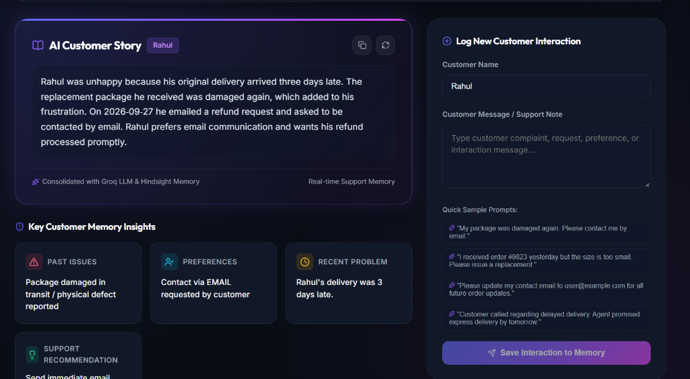
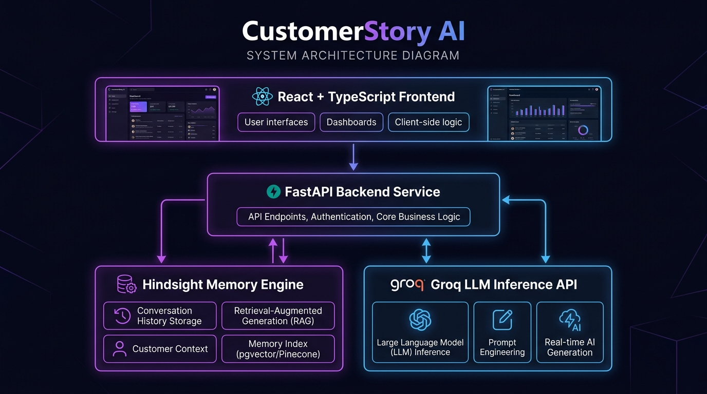
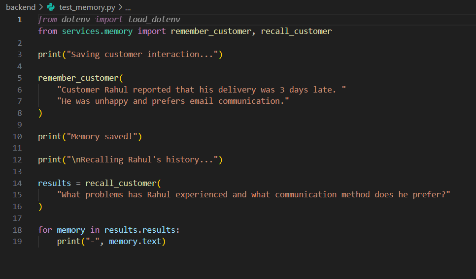
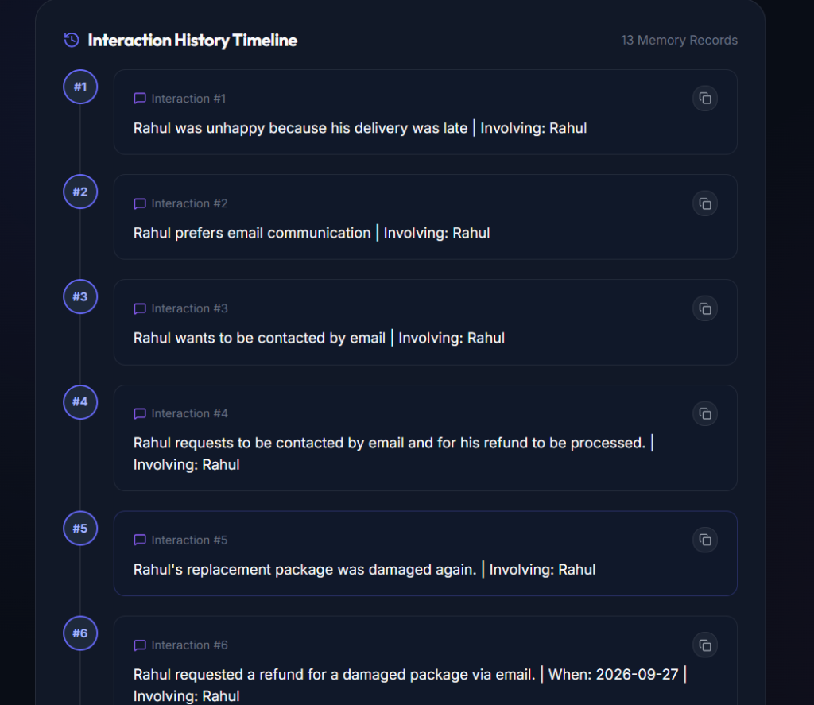

# From Raw Chat Logs to Customer Stories using Hindsight

## Introduction

When building AI tools for customer support, one of the primary technical challenges is handling long-term memory. Customer interactions occur over days, weeks, or months across different channels. A customer might report a shipping delay on Monday, express frustration over product setup on Wednesday, and request a refund by Friday. 

Standard large language model (LLM) implementations struggle with this pattern. Passing an ever-expanding array of raw chat transcripts into every prompt consumes excessive tokens and makes context extraction noisy. Conversely, stateless LLM calls forget past customer issues entirely.

To solve this, I built **CustomerStory AI**—an application that captures unstructured support notes, retains them in a persistent episodic memory layer using **Hindsight**, and synthesizes them into actionable customer background stories using **FastAPI**, **Groq**, and **React**. 



In this article, I will walk through the architecture, memory retention pipeline, prompt grounding strategy, and real-world frontend adjustments required to integrate Hindsight into a full-stack local setup.

---

## Technical Stack and Architecture Overview

The system is structured as a decoupled full-stack application:

* **Backend**: FastAPI (Python 3.11+) handling REST API endpoints, memory operations, and LLM orchestration.
* **Memory Engine**: Hindsight instance running locally (`http://localhost:8888`), accessed via the `hindsight-client` Python SDK.
* **LLM Inference**: Groq API using the `openai/gpt-oss-20b` model for prompt completion.
* **Frontend**: React application built with TypeScript and Vite, featuring a dashboard that highlights customer stories, timelines, and analytical insights.



```
React Frontend
      ↓
FastAPI Backend
   ↙       ↘
Hindsight   Groq
```

---

## Retaining and Recalling Customer Memories

Rather than managing custom vector embeddings or manually querying a relational database for past notes, I integrated Hindsight as a long-term memory engine. In my backend service layer (`services/memory.py`), I instantiated the Hindsight client targeting a local instance:



```python
from hindsight_client import Hindsight

client = Hindsight(
    base_url="http://localhost:8888"
)

BANK_ID = "customer-story"


def remember_customer(interaction: str):
    return client.retain(
        bank_id=BANK_ID,
        content=interaction,
        context="customer support interaction"
    )


def recall_customer(query: str):
    return client.recall(
        bank_id=BANK_ID,
        query=query
    )
```

When a user submits a customer interaction note in the application, FastAPI processes the payload in `/customer/message` and passes the text directly to `remember_customer()`:

```python
@app.post("/customer/message")
def save_customer_message(data: CustomerMessage):
    interaction = f"Customer {data.customer_name} said: {data.message}"
    remember_customer(interaction)

    return {
        "message": "Customer interaction saved successfully!",
        "customer": data.customer_name
    }
```

By storing interaction snippets inside the `"customer-story"` memory bank with explicit context (`"customer support interaction"`), Hindsight indexes the semantic content. When I need to review a customer's history, calling `recall_customer()` returns relevant factual memories based on natural language queries without requiring the backend to reload and parse historical chat logs manually.

---

## Grounding LLM Summaries

Generating customer background stories requires turning raw recalled factual fragments into a readable paragraph. A common risk with LLM summarization is hallucination—where the model introduces assumed facts or invents details not present in the customer's history.

To prevent this in CustomerStory AI, I structured the `/customer/{customer_name}/summary` endpoint to retrieve relevant memories from Hindsight first, then pass those exact memories to Groq (`openai/gpt-oss-20b`) with tight prompt constraints and a low temperature (`0.2`):

```python
@app.get("/customer/{customer_name}/summary")
def get_customer_summary(customer_name: str):
    query = f"What is the complete story of customer {customer_name}?"
    results = recall_customer(query)

    memories = [memory.text for memory in results.results]
    memory_text = "\n".join(memories)

    prompt = f"""
You are a customer support assistant.

Create a short, clear customer story from the information below.

Customer: {customer_name}

Memory:
{memory_text}

Include:
- important past problems
- what made the customer unhappy
- preferences
- recent issues

Do not invent any information.
Keep the answer to 3-4 sentences.
"""

    response = groq_client.chat.completions.create(
        model="openai/gpt-oss-20b",
        messages=[
            {
                "role": "user",
                "content": prompt
            }
        ],
        temperature=0.2
    )

    summary = response.choices[0].message.content

    return {
        "customer": customer_name,
        "summary": summary
    }
```

The combination of feeding only Hindsight-recalled memory strings into the prompt, explicitly instructing the model `"Do not invent any information"`, and setting `temperature=0.2` ensures the resulting summary remains grounded strictly in recorded customer events.

---

## Frontend Integration and Handling Local Hindsight Concurrency

The frontend dashboard is built in React with TypeScript, using custom styling for visual hierarchy. It includes components like `CustomerStoryCard` for displaying synthesized summaries, `CustomerInsights` for categorizing risks and preferences, and `InteractionHistory` for timeline views.



During local testing, I encountered an operational challenge: when selecting a customer profile, the frontend initially issued concurrent requests to `/customer/{name}/history` and `/customer/{name}/summary` simultaneously via `Promise.all()`. 

Because both endpoints query the underlying local Hindsight service at the same instant, sending parallel requests occasionally caused local database lock contention and 500 errors from the Hindsight instance running on `localhost:8888`.

To fix this issue reliably in `App.tsx`, I updated the state management logic to execute requests sequentially instead of in parallel:

```typescript
const fetchCustomerData = useCallback(async (customerName: string) => {
  if (!customerName.trim()) return;

  setApiError(null);
  setIsHistoryLoading(true);
  setIsSummaryLoading(true);

  // 1. Fetch History FIRST
  try {
    const historyData = await api.getHistory(customerName);
    setHistory(historyData.history || []);
  } catch (err) {
    console.error('Failed to fetch customer history:', err);
    setHistory([]);
  } finally {
    setIsHistoryLoading(false);
  }

  // 2. Fetch Summary SECOND (prevents concurrent Hindsight DB lock)
  try {
    const summaryData = await api.getSummary(customerName);
    setSummary(summaryData.summary || '');
  } catch (err) {
    console.error('Failed to fetch customer summary:', err);
    setSummary('');
  } finally {
    setIsSummaryLoading(false);
  }
}, []);
```

Sequential execution eliminated the database lock conflicts on the local Hindsight backend, ensuring smooth data loading across the React interface.

---

## Current Setup and Practical Takeaways

In its current state, CustomerStory AI serves as a local proof-of-concept. All customer memories are stored in a single Hindsight bank ID (`BANK_ID = "customer-story"`), and backend routes target a local Hindsight server instance. 

Building this project highlighted several key takeaways for integrating episodic memory into AI applications:

1. **Decoupled Memory Operations**: Storing unstructured notes via `client.retain()` keeps data ingestion decoupled from summarization logic.
2. **Strict Prompt Grounding**: Relying on recalled context combined with low temperature settings keeps generated summaries accurate without hallucination.
3. **Operational Awareness**: Local services like Hindsight may require sequential request orchestration in client applications to prevent concurrency conflicts during developmental testing.

Using Hindsight alongside FastAPI, Groq, and React provides a pragmatic pattern for transforming raw customer logs into clear, persistent customer stories.
